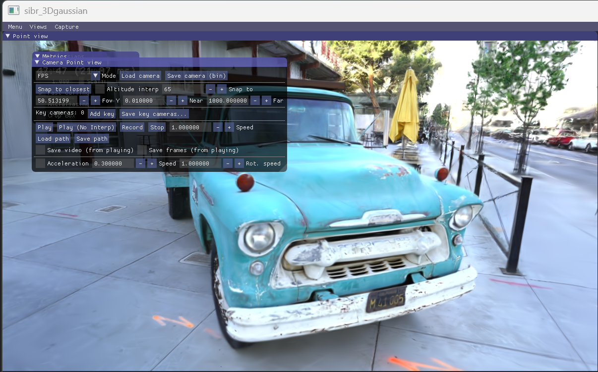

# 3D Gaussian Splatting（3DGS）首次实战记录

> 记录从环境准备、理解核心概念，到使用公开数据集完成训练、渲染和三维查看的过程。
>
> 当前实验场景：官方 Tanks and Temples 数据集中的 `Truck` 场景。

---

## 目录

- [1. 项目目标与当前进度](#1-项目目标与当前进度)
- [2. 当前开发环境](#2-当前开发环境)
- [3. 已经学习的核心概念](#3-已经学习的核心概念)

---

## 1. 项目目标与当前进度

本项目用于学习 3D Gaussian Splatting（3DGS），并逐步探索如何将其应用到大范围校园场景的三维重建。

### 学习目标

1. 理解 3DGS 的基本表示方法和渲染原理。
2. 在 Windows 环境中配置并运行官方 Graphdeco 3DGS 实现。
3. 使用公开数据集，而不是自己采集照片，完成一次端到端实验。
4. 学会查看训练日志、渲染结果、模型文件和三维可视化结果。
5. 为后续的大规模场景重建学习相机位姿、分块训练、坐标对齐和几何质量验证。

### 当前进度

- [x] 获取并运行 Graphdeco 官方 3DGS 代码。
- [x] 准备公开 Truck 场景数据。
- [x] 检查 COLMAP 稀疏重建文件。
- [x] 完成一次 7,000 次迭代的训练实验。
- [x] 渲染训练视角的 PNG 图片。
- [x] 使用 SIBR 查看器查看训练后的三维高斯场景。



## 2. 当前开发环境

### 操作系统与硬件

| 项目 | 当前情况                        |
|---|---------------------------------|
| 操作系统 | Windows                         |
| GPU | NVIDIA GPU，约 12 GB 显存       |
| 编程语言 | Python                          |
| 三维重建工具 | COLMAP                          |
| 3DGS 实现 | Graphdeco-Inria 官方仓库        |
| 可视化工具 | SIBR Viewer                     |
| 实验数据 | Tanks and Temples 的 Truck 场景 |


### 代码仓库

Graphdeco 官方仓库：

- https://github.com/graphdeco-inria/gaussian-splatting

本机代码路径：

```text
D:\tasks\campus3d\gaussian-splatting
```

### 数据集

使用的是公开 Tanks and Temples / Deep Blending 数据包中的 Truck 场景。数据根目录为：

```text
D:\tasks\campus3d\datasets\tandt_db\tandt\truck
```

该目录中已经检查到 COLMAP 稀疏重建文件，例如：

```text
sparse\0\cameras.bin
sparse\0\images.bin
sparse\0\points3D.bin
```

### 查看器

```text
SIBR_gaussianViewer_app.exe
```

## 3. 已经学习的核心概念

### 3.1 什么是 3D Gaussian Splatting？

3DGS 是一种用于新视角合成和三维场景表示的方法。它使用大量三维高斯基元表示场景，并通过可微分渲染来优化这些基元的参数。

一个三维高斯通常包含：

- **位置（Position）**：高斯在三维空间中的中心位置。
- **协方差 / 形状与方向（Covariance）**：决定高斯在空间中的大小、扁长程度和朝向。实际实现通常通过尺度和旋转参数进行表示。
- **不透明度（Opacity）**：控制该高斯对最终像素的透明度贡献。
- **颜色（Color）**：可以使用球谐函数（Spherical Harmonics，SH）表达随观察方向变化的颜色。

渲染时，三维高斯被投影到图像平面，并按深度顺序进行透明度合成，生成最终像素颜色。

### 3.2 为什么需要很多高斯？

单个高斯无法表达复杂物体。大量不同大小、方向、颜色和透明度的高斯组合起来，才能近似表示场景中的表面、纹理和细节。

训练过程中，算法会根据图像误差优化高斯参数，并通过密集化（densification）等机制调整高斯的数量和分布。

### 3.3 训练在优化什么？

简化理解，训练会让当前模型渲染出来的图像尽量接近输入照片。原始 3DGS 方法使用图像重建损失，并结合结构相似性等项优化结果。

这意味着：

- 训练视角下的图片可能非常逼真。
- 这不等于模型具有严格准确、封闭或完整的实体表面。
- 对于遮挡区域、没有被充分观察的区域，三维结构可能不可靠。
- 如果目标包含测量、工程或几何分析，需要额外进行几何质量验证，不能只看渲染图片。

### 3.4 什么是训练视角与新视角？

- **训练视角**：输入数据中实际拍摄过的相机视角。
- **新视角**：相机移动到输入照片没有直接覆盖的位置或方向。

训练视角的渲染结果可以很好，但新视角仍可能出现漂浮、破碎、模糊或缺失。这是评估三维表示时需要注意的现象。

### 3.5 3DGS 与 COLMAP 的关系

可以把当前工作流简化为：

```text
多张输入照片
      │
      ▼
COLMAP：估计相机内参、相机位姿和稀疏三维点
      │
      ▼
Graphdeco 3DGS：初始化高斯并优化场景表示
      │
      ├──► 训练视角 / 新视角渲染
      │
      └──► point_cloud.ply：训练后的高斯参数
                    │
                    ▼
              SIBR Viewer 三维查看
```

COLMAP 文件通常包括：

- `cameras.bin`：相机模型和内参。
- `images.bin`：图像名称、相机姿态以及图像特征关联等信息。
- `points3D.bin`：稀疏三维点及相关信息。

训练后输出的 `point_cloud.ply` 与 COLMAP 的 `points3D.bin` 不一样：

- `points3D.bin` 是 COLMAP 的稀疏重建结果。
- `point_cloud.ply` 在此实验中保存训练后的 3DGS 高斯参数。

因此，不要仅凭 COLMAP 的稀疏点云外观，就判断训练后的 3DGS 模型是否完整。

---